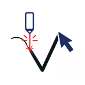

<p align="center">
  <a href="https://vectorcutter.oldlane17.com">
    
  </a>
</p>

<h1 align="center">VectorCutter</h1>

<p align="center">
  <strong>A free, client-side vector SVG editor and parametric generator toolkit built for laser cutting, CNC, and precision making.</strong><br/>
  Create precision laser-ready SVG files directly in your browser — zero installation, zero build steps, 100% private.
</p>

<p align="center">
  <a href="https://vectorcutter.oldlane17.com"></a>
</p>

<p align="center">
  <a href="LICENSE"></a>
  <a href="https://pages.cloudflare.com"></a>
  <a href="#-contributing-to-vectorcutter"></a>
  
  
  
  
</p>

<p align="center">
  <a href="#-why-vectorcutter">✨ Why VectorCutter</a> ·
  <a href="#-tools--generators">🧰 Tools</a> ·
  <a href="#-modular-architecture">🧩 Architecture</a> ·
  <a href="#-quickstart">🚀 Quickstart</a> ·
  <a href="#-cloudflare-pages-deployment">⚡ Cloudflare Pages</a> ·
  <a href="#-contributing-to-vectorcutter">🤝 Contributing</a> ·
  <a href="#-license">📄 License</a>
</p>

---

## ✨ Why VectorCutter?

| Feature | What It Means for Makers |
|:---|:---|
| ⚡ **Zero Installation & Zero Build** | Pure HTML, CSS, and modern JavaScript. No `npm install`, no webpack, no dependencies, no server runtime. Open and run instantly. |
| 🔒 **100% Client-Side & Private** | Everything executes inside your browser. No telemetry, no accounts, no cloud database. Your designs never leave your computer. |
| ✂️ **Laser & CNC Optimized** | Real-world units (mm, cm, inches), hairline stroke weights, kerf-friendly geometries, and a one-click **Laser Cutting Mode** (`#000000`, 1px cut line). |
| 🧮 **Native LaTeX / MathJax Rendering** | Type mathematical equations (e.g., `E = mc^2`, `\int_0^\infty f(x)dx`) and render them as crisp, laserable vector paths. |
| 🧩 **Parametric Generators** | Instantly generate laser-cut-ready rulers, chessboards, puzzles, advent calendars, and popup cards with custom dimensions. |
| 🖥️ **Compatible with Laser Software** | Clean SVG outputs that import directly into **LightBurn**, **RDWorks**, **LaserWeb**, **Glowforge UI**, **Cricut Design Space**, **Inkscape**, and **Illustrator**. |

---

## 🧰 Tools & Generators

Each tool is a self-contained, lightweight interface designed for precision maker workflows:

| Tool | Launch Link | Description | Output |
|:---|:---|:---|:---|
| 📐 **SVG Editor** | [`editor.html`](editor.html) | Full-featured vector editor with paths, shapes, curves, MathJax LaTeX text, snapping, rotation center, and two-way live SVG code editing | Cutting & engraving SVG / PNG |
| ♟️ **Chessboard Generator** | [`chessboard.html`](chessboard.html) | Parametric chessboard generator with configurable square dimensions (mm), notation borders, and optional engraving layers | Laser-ready board SVG |
| 📏 **Ruler Generator** | [`ruler.html`](ruler.html) | Metric (mm/cm) and Imperial (inch) ruler designer with custom tick intervals, fine calibrations, and font engravings | Precision measuring tool SVG |
| 🧩 **Puzzle Generator** | [`puzzle.html`](puzzle.html) | Jigsaw puzzle creator with adjustable rows, columns, piece dimensions, and tab/blank interlocking curves | Interlocking cut paths SVG |
| 📅 **Advent Calendar** | [`advent_calendar.html`](advent_calendar.html) | Parametric door matrix layout with numbered doors, hinge tabs, and custom engraving bounds | Hinged door cut SVG |
| 🪪 **Pop-Up Card Generator** | [`popup.html`](popup.html) | Layered 3D papercraft and popup card mechanism designer with cut, mountain, and valley fold lines | Flat cut/score SVG |
| 🏠 **Dashboard** | [`index.html`](index.html) | Homepage displaying recent saved local browser projects and quick generator launchers | Project launcher |

---

## 🧩 Modular Architecture

The repository is built around clean, separated responsibilities with **zero build step**, making it exceptionally easy to read, debug, and extend:

```
VectorCutter/
├── components/                      # Shared reusable layout components
│   ├── layout.css                  # Universal topnav & footer CSS variables, responsive drawer & theme
│   ├── header.js                   # <site-header> Web Component (desktop nav + mobile drawer + shortcuts)
│   ├── footer.js                   # <site-footer> Web Component (with GitHub reference link & copyright)
│   ├── header.html                 # Raw HTML partial of top navigation
│   └── footer.html                 # Raw HTML partial of footer
├── editor/                         # Modular SVG Editor architecture
│   ├── css/
│   │   └── editor.css              # Clean editor styling (canvas, tools sidebar, properties panel, modals)
│   └── js/
│       ├── editor-core.js          # SVGEditor class, lifecycle, undo/redo history, clipboard, shortcuts
│       ├── editor-canvas.js        # ViewBox, coordinate systems, axes, millimeter grid, pan & zoom
│       ├── editor-tools.js         # Tool modes, mouse event dispatch (down/move/up), element creation
│       ├── editor-selection.js     # Marquee selection, bounding boxes, handles, snap targets
│       ├── editor-transform.js     # Resize, rotate, scale, flip, reflect, translate, arrow keys
│       ├── editor-properties.js    # Properties panel, coordinate inputs, LaTeX MathJax rendering, styles
│       ├── editor-elements-tree.js # Elements tree hierarchy, grouping, path/group splitting
│       ├── editor-laser-mode.js    # Laser cutting mode toggle & recursive stroke/fill overrides
│       ├── editor-export.js        # Clean SVG serialization, text flattening, PNG export
│       ├── editor-templates.js     # Parametric Star & N-Gon shape generators, starter SVGs
│       ├── editor-code.js          # Live SVG code viewer, code modal, two-way code updates
│       └── editor-init.js          # Modal helpers, clipboard copy, URL parameter autoloading
├── index.html                      # Project dashboard & launcher
├── editor.html                     # Primary SVG Editor entrypoint (clean, modular HTML)
├── editor_5.8.html                 # Backwards-compatibility redirect to editor.html
├── chessboard.html                 # Chessboard generator
├── ruler.html                      # Ruler generator
├── puzzle.html                     # Puzzle generator
├── advent_calendar.html            # Advent Calendar generator
├── popup.html                      # Pop-Up Card generator
├── about.html                      # About VectorCutter & Old Lane 17
├── legal-notice.html               # Legal notice
├── privacy-policies.html           # Privacy policies
├── terms-of-service.html           # Terms of service
├── wrangler.toml                   # Cloudflare Pages zero-configuration deployment manifest
├── _redirects                      # Cloudflare Pages route redirects (/editor -> /editor.html)
├── _headers                        # Security headers & asset caching rules
├── sidebar/                        # Sidebar SVG icons (tools, zoom, snap, etc.)
└── templates/                      # Starter SVG templates (leather badge, stars, etc.)
```

### Shared Header & Footer Components

All generator and information pages import the universal header and footer with two simple custom tags:

```html
<!-- Include in <head> -->
<link rel="stylesheet" href="components/layout.css">
<script src="components/header.js" defer></script>
<script src="components/footer.js" defer></script>

<!-- Place inside <body> -->
<site-header></site-header>

<!-- Your tool or page markup goes here -->

<site-footer></site-footer>
```

- **`<site-header>`**: Renders the brand logo, direct tool links, a generators dropdown menu, active page indicator, and an animated mobile drawer with touch/click backdrop and keyboard (<kbd>Escape</kbd>) support.
- **`<site-footer>`**: Renders legal, FAQ, social links, copyright, and a direct link back to the **[GitHub Repository](https://github.com/oldlane17/VectorCutter)**.

---

## 🚀 Quickstart

### Option 1 — Open directly in your browser (No installation!)

Clone the repository and double-click any `.html` file:

```bash
git clone https://github.com/oldlane17/VectorCutter.git
cd VectorCutter
# Open index.html or editor.html directly in Chrome, Firefox, Safari, or Edge!
```

### Option 2 — Serve locally with a lightweight HTTP server (Recommended)

Running a local HTTP server avoids browser local-file CORS restrictions when loading MathJax fonts and SVG templates:

**Using Python 3:**
```bash
python -m http.server 8080
# Visit http://localhost:8080
```

**Using Node.js (`npx`):**
```bash
npx serve .
```

**Using VS Code:**
Install the [Live Server](https://marketplace.visualstudio.com/items?itemName=ritwickdey.LiveServer) extension, open `index.html`, and click **Go Live**.

---

## ⚡ Cloudflare Pages Deployment

VectorCutter is optimized for continuous deployment through **Cloudflare Pages**:

1. **Automatic Git Sync:** Pushing commits to `main` triggers an automatic, instant build and deployment.
2. **Zero-Build Configuration:** Because VectorCutter is 100% static, the deployment requires no build command or external package manager.
3. **`wrangler.toml` Manifest:**
   ```toml
   name = "vectorcutter"
   compatibility_date = "2024-01-01"
   pages_build_output_dir = "."
   ```
4. **URL Routing & Caching:**
   - [`_redirects`](_redirects) maps `/editor`, `/editor/`, and `/editor_5.8.html` to `/editor.html`.
   - [`_headers`](_headers) enforces strict security headers (`X-Content-Type-Options`, `X-Frame-Options`) and enables high-performance browser caching for JS, CSS, and SVG assets.

---

## 🤝 Contributing to VectorCutter

> **🌟 Everyone is welcome to contribute!**  
> Whether you are an experienced web developer, a laser cutting hobbyist, a teacher, a mathematician, or making your very first pull request on GitHub — we'd love to have you participate.

### Why contributing to VectorCutter is fun and easy:
- **No build fatigue:** You don't need to fiddle with Webpack, Vite, Babel, npm dependencies, or TypeScript compile errors.
- **Instant feedback:** Edit an HTML, CSS, or JS file, refresh your browser, and you immediately see the result.
- **Real-world impact:** Thousands of makers, woodworkers, leathercrafters, and educators use these SVGs for physical laser cutting and CNC fabrication.

---

### 🎯 Exciting Ideas for Contributions

Looking for inspiration? Here are areas where contributions are actively welcome:

#### 🟢 Beginner Friendly / Quick Wins
- [ ] **New Starter Templates:** Add creative vector templates to [`templates/`](templates/) (e.g. keychains, leather coaster badges, holiday ornaments, bookmarks, luggage tags).
- [ ] **Sidebar Icons & UI Polish:** Improve icon clarity, accessibility contrast, or mobile layout spacing.
- [ ] **Keyboard Shortcuts Visual Modal:** Create a friendly visual shortcut cheatsheet (<kbd>?</kbd> or <kbd>Ctrl</kbd>+<kbd>/</kbd>).
- [ ] **Documentation & Translations:** Improve guides, add tooltips, or translate generator labels.

#### 🟡 New Parametric Generators
Create a new standalone generator page (like `box.html` or `gears.html`) using the shared `<site-header>` and `<site-footer>`:
- [ ] **Finger-Joint Box Generator:** Configurable width, height, depth, material thickness, and finger-tab spacing for laser-cut boxes.
- [ ] **Involute Gear & Cogwheel Generator:** Generate gear teeth based on module, tooth count, pressure angle, and shaft hole diameter.
- [ ] **Living Hinge Generator:** Create flexible wood lattice cut patterns with customizable cut lengths and bridge spacings.
- [ ] **Text Stencil Bridge Generator:** Automatically bridge closed letters (like O, P, B, A, D, R) for clean laser stencil cutting.
- [ ] **Circular Dial & Gauge Generator:** Create custom protractor, volume dial, or clock face tick marks.

#### 🟣 SVG Editor Enhancements
Enhance [`editor/js/`](editor/js/):
- [ ] **Alignment & Distribution Toolbar:** Align selected elements (left, center, right, top, middle, bottom) and distribute evenly horizontally/vertically.
- [ ] **Laser Color Palette Presets:** One-click color swatches tailored for laser workflows (Cut = Red `#FF0000`, Engrave = Black `#000000`, Score = Blue `#0000FF`).
- [ ] **Export to DXF / PDF:** Complement SVG export with DXF or vector PDF generation for legacy laser software.
- [ ] **Path Operations (Boolean):** Add basic union, difference, and intersection path calculations.

---

### 🛠️ Step-by-Step Contribution Workflow

1. **Fork the Repository**  
   Click the **Fork** button at the top-right of [github.com/oldlane17/VectorCutter](https://github.com/oldlane17/VectorCutter).

2. **Clone Your Fork**
   ```bash
   git clone https://github.com/YOUR_USERNAME/VectorCutter.git
   cd VectorCutter
   ```

3. **Create a Feature Branch**
   ```bash
   git checkout -b feature/finger-joint-box-generator
   ```

4. **Make Your Changes**  
   - If adding a generator: create your new `.html` page, add `<site-header></site-header>` and `<site-footer></site-footer>`, and link it in the dropdown.
   - If improving the editor: make edits inside the relevant module in [`editor/js/`](editor/js/) or [`editor/css/`](editor/css/).

5. **Test Your Changes Locally**  
   Run a local server (`npx serve .` or `python -m http.server 8080`) and verify your changes in your browser console with no JavaScript errors.

6. **Commit & Push**
   ```bash
   git commit -m "feat: add finger-joint box generator with parametric tabs"
   git push origin feature/finger-joint-box-generator
   ```

7. **Submit a Pull Request**  
   Go to your fork on GitHub and click **Compare & pull request**. Describe your changes, add a screenshot or GIF if applicable, and submit!

> **Friendly Promise:** Don't worry if your code isn't 100% polished! We are happy to review, offer suggestions, and help you get your pull request merged.

---

## 📄 License

VectorCutter is open-source software licensed under the **[MIT License](LICENSE)**. You are free to use, modify, distribute, and build commercial or non-commercial physical items with these tools.

---

<p align="center">
  Built with passion for the maker and education community by <a href="https://oldlane17.com"><strong>Old Lane 17</strong></a>.<br/>
  <em>If VectorCutter helped your laser cutting or maker project, star ⭐ the repo and share your creations!</em>
</p>
